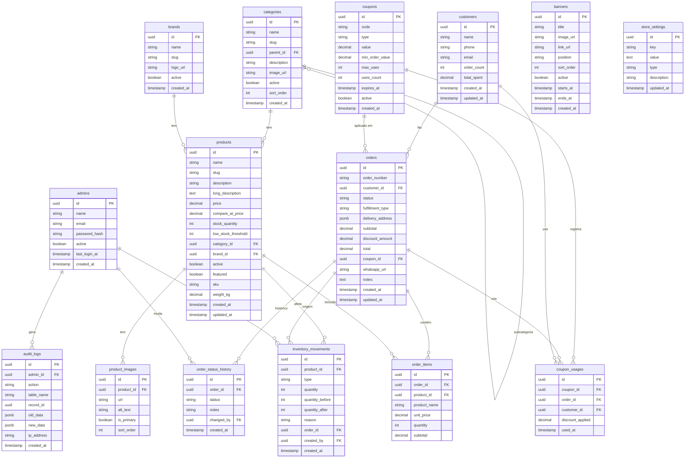

# Banco de Dados — Eterna Cosméticos

## Visão Geral

O banco utiliza **PostgreSQL 14+**. Todas as tabelas usam UUID como chave primária para melhor distribuição e segurança.

---

## Diagrama Entidade-Relacionamento



---

## Descrição das Tabelas

### `admins`
Usuários com acesso ao painel administrativo.

| Coluna           | Tipo        | Descrição                              |
|------------------|-------------|----------------------------------------|
| `id`             | UUID        | Chave primária                         |
| `name`           | VARCHAR     | Nome do administrador                  |
| `email`          | VARCHAR     | E-mail único de login                  |
| `password_hash`  | VARCHAR     | Senha hashed com bcrypt (cost 12)      |
| `active`         | BOOLEAN     | Se o usuário está ativo                |
| `last_login_at`  | TIMESTAMPTZ | Último login registrado                |
| `created_at`     | TIMESTAMPTZ | Data de criação                        |

---

### `categories`
Categorias de produtos (suporta hierarquia pai/filho).

| Coluna        | Tipo    | Descrição                              |
|---------------|---------|----------------------------------------|
| `id`          | UUID    | Chave primária                         |
| `name`        | VARCHAR | Nome da categoria                      |
| `slug`        | VARCHAR | URL amigável único                     |
| `parent_id`   | UUID FK | Referência à categoria pai (nullable)  |
| `description` | TEXT    | Descrição opcional                     |
| `image_url`   | VARCHAR | URL da imagem da categoria             |
| `active`      | BOOLEAN | Visibilidade na loja                   |
| `sort_order`  | INT     | Ordenação manual                       |

---

### `brands`
Marcas dos produtos.

| Coluna      | Tipo    | Descrição              |
|-------------|---------|------------------------|
| `id`        | UUID    | Chave primária         |
| `name`      | VARCHAR | Nome da marca          |
| `slug`      | VARCHAR | URL amigável único     |
| `logo_url`  | VARCHAR | URL do logo            |
| `active`    | BOOLEAN | Visibilidade na loja   |

---

### `products`
Catálogo de produtos da loja.

| Coluna                | Tipo         | Descrição                                       |
|-----------------------|--------------|-------------------------------------------------|
| `id`                  | UUID         | Chave primária                                  |
| `name`                | VARCHAR      | Nome do produto                                 |
| `slug`                | VARCHAR      | URL amigável único                              |
| `description`         | TEXT         | Descrição curta (listagem)                      |
| `long_description`    | TEXT         | Descrição completa (página do produto)          |
| `price`               | DECIMAL(10,2)| Preço de venda                                  |
| `compare_at_price`    | DECIMAL(10,2)| Preço "de" (riscado), opcional                  |
| `stock_quantity`      | INT          | Estoque atual                                   |
| `low_stock_threshold` | INT          | Alerta de estoque baixo (padrão: 5)             |
| `category_id`         | UUID FK      | Categoria do produto                            |
| `brand_id`            | UUID FK      | Marca do produto                                |
| `active`              | BOOLEAN      | Visível na loja                                 |
| `featured`            | BOOLEAN      | Destaque na home                                |
| `sku`                 | VARCHAR      | Código interno (opcional, único)                |
| `weight_kg`           | DECIMAL(5,3) | Peso para cálculo de frete (opcional)           |

---

### `product_images`
Imagens associadas a um produto.

| Coluna       | Tipo    | Descrição                         |
|--------------|---------|-----------------------------------|
| `id`         | UUID    | Chave primária                    |
| `product_id` | UUID FK | Produto ao qual pertence          |
| `url`        | VARCHAR | Caminho/URL da imagem             |
| `alt_text`   | VARCHAR | Texto alternativo (acessibilidade)|
| `is_primary` | BOOLEAN | Imagem principal do produto       |
| `sort_order` | INT     | Ordenação das fotos               |

---

### `customers`
Clientes que realizaram pedidos (criados automaticamente ao fazer pedido).

| Coluna         | Tipo          | Descrição                              |
|----------------|---------------|----------------------------------------|
| `id`           | UUID          | Chave primária                         |
| `name`         | VARCHAR       | Nome do cliente                        |
| `phone`        | VARCHAR       | Telefone (único, usado como chave)     |
| `email`        | VARCHAR       | E-mail (opcional)                      |
| `order_count`  | INT           | Total de pedidos realizados            |
| `total_spent`  | DECIMAL(10,2) | Total gasto acumulado                  |

---

### `orders`
Pedidos realizados pelos clientes.

| Coluna             | Tipo          | Descrição                                   |
|--------------------|---------------|---------------------------------------------|
| `id`               | UUID          | Chave primária                              |
| `order_number`     | VARCHAR       | Número legível (ex: `ET-20241113-0001`)     |
| `customer_id`      | UUID FK       | Cliente que fez o pedido                    |
| `status`           | VARCHAR       | Status atual (ver fluxo abaixo)             |
| `fulfillment_type` | VARCHAR       | `pickup` (retirada) ou `delivery` (entrega) |
| `delivery_address` | JSONB         | Endereço de entrega (nullable)              |
| `subtotal`         | DECIMAL(10,2) | Total antes do desconto                     |
| `discount_amount`  | DECIMAL(10,2) | Valor do desconto aplicado                  |
| `total`            | DECIMAL(10,2) | Total final a pagar                         |
| `coupon_id`        | UUID FK       | Cupom utilizado (nullable)                  |
| `whatsapp_url`     | TEXT          | Link wa.me gerado para contato              |
| `notes`            | TEXT          | Observações do pedido                       |

**Status possíveis:**
- `pending_contact` → `confirmed` → `preparing` → `ready` → `completed`
- Qualquer status → `cancelled`

---

### `order_items`
Itens de cada pedido (snapshot do produto no momento da compra).

| Coluna         | Tipo          | Descrição                                       |
|----------------|---------------|-------------------------------------------------|
| `id`           | UUID          | Chave primária                                  |
| `order_id`     | UUID FK       | Pedido ao qual pertence                         |
| `product_id`   | UUID FK       | Produto (nullable se produto for deletado)      |
| `product_name` | VARCHAR       | Nome do produto no momento da compra (snapshot) |
| `unit_price`   | DECIMAL(10,2) | Preço unitário no momento da compra             |
| `quantity`     | INT           | Quantidade solicitada                           |
| `subtotal`     | DECIMAL(10,2) | `unit_price × quantity`                         |

---

### `coupons`
Cupons de desconto.

| Coluna            | Tipo          | Descrição                              |
|-------------------|---------------|----------------------------------------|
| `id`              | UUID          | Chave primária                         |
| `code`            | VARCHAR       | Código do cupom (único, case-insensitive) |
| `type`            | VARCHAR       | `percentage` ou `fixed`               |
| `value`           | DECIMAL(10,2) | Percentual ou valor fixo de desconto   |
| `min_order_value` | DECIMAL(10,2) | Valor mínimo do pedido para usar       |
| `max_uses`        | INT           | Limite de usos (null = ilimitado)      |
| `uses_count`      | INT           | Quantas vezes já foi usado             |
| `expires_at`      | TIMESTAMPTZ   | Data de expiração (null = sem prazo)   |
| `active`          | BOOLEAN       | Se o cupom está ativo                  |

---

### `inventory_movements`
Histórico de movimentações de estoque (entradas, saídas, ajustes).

| Coluna            | Tipo | Descrição                                             |
|-------------------|------|-------------------------------------------------------|
| `id`              | UUID | Chave primária                                        |
| `product_id`      | UUID FK | Produto afetado                                   |
| `type`            | VARCHAR | `in` (entrada), `out` (saída), `adjustment`       |
| `quantity`        | INT  | Quantidade movimentada (positivo = entrada)            |
| `quantity_before` | INT  | Estoque antes da movimentação                         |
| `quantity_after`  | INT  | Estoque depois da movimentação                        |
| `reason`          | VARCHAR | Motivo (ex: "compra", "venda pedido ET-001")      |
| `order_id`        | UUID FK | Pedido que originou (nullable)                    |
| `created_by`      | UUID FK | Admin que registrou (nullable para saídas automáticas)|

---

### `banners`
Banners da página inicial e outras seções.

| Coluna       | Tipo        | Descrição                                   |
|--------------|-------------|---------------------------------------------|
| `id`         | UUID        | Chave primária                              |
| `title`      | VARCHAR     | Título/descrição interna                    |
| `image_url`  | VARCHAR     | URL da imagem do banner                     |
| `link_url`   | VARCHAR     | Link ao clicar (nullable)                   |
| `position`   | VARCHAR     | Posição (ex: `home_hero`, `home_promo`)     |
| `sort_order` | INT         | Ordenação                                   |
| `active`     | BOOLEAN     | Se está ativo                               |
| `starts_at`  | TIMESTAMPTZ | Início da exibição (nullable)               |
| `ends_at`    | TIMESTAMPTZ | Fim da exibição (nullable)                  |

---

### `store_settings`
Configurações globais da loja (chave-valor).

| Coluna        | Tipo    | Descrição                                       |
|---------------|---------|-------------------------------------------------|
| `key`         | VARCHAR | Chave única (ex: `store_name`, `whatsapp_number`)|
| `value`       | TEXT    | Valor da configuração                           |
| `type`        | VARCHAR | Tipo do valor (`string`, `boolean`, `number`, `json`) |
| `description` | VARCHAR | Descrição legível da configuração               |

---

### `audit_logs`
Log de auditoria de ações administrativas.

| Coluna       | Tipo    | Descrição                                |
|--------------|---------|------------------------------------------|
| `id`         | UUID    | Chave primária                           |
| `admin_id`   | UUID FK | Admin que realizou a ação               |
| `action`     | VARCHAR | Ação (ex: `create`, `update`, `delete`) |
| `table_name` | VARCHAR | Tabela afetada                           |
| `record_id`  | UUID    | ID do registro afetado                  |
| `old_data`   | JSONB   | Estado anterior (nullable)              |
| `new_data`   | JSONB   | Novo estado (nullable)                  |
| `ip_address` | VARCHAR | IP do administrador                     |

---

## Índices Criados

```sql
-- Busca e filtros de produtos
CREATE INDEX idx_products_category_id ON products(category_id);
CREATE INDEX idx_products_brand_id ON products(brand_id);
CREATE INDEX idx_products_active ON products(active);
CREATE INDEX idx_products_featured ON products(featured);
CREATE INDEX idx_products_slug ON products(slug);

-- Slugs únicos
CREATE UNIQUE INDEX idx_categories_slug ON categories(slug);
CREATE UNIQUE INDEX idx_brands_slug ON brands(slug);
CREATE UNIQUE INDEX idx_products_slug_unique ON products(slug);

-- Pedidos
CREATE INDEX idx_orders_customer_id ON orders(customer_id);
CREATE INDEX idx_orders_status ON orders(status);
CREATE INDEX idx_orders_created_at ON orders(created_at DESC);
CREATE UNIQUE INDEX idx_orders_order_number ON orders(order_number);

-- Estoque
CREATE INDEX idx_inventory_movements_product_id ON inventory_movements(product_id);
CREATE INDEX idx_inventory_movements_created_at ON inventory_movements(created_at DESC);

-- Cupons
CREATE UNIQUE INDEX idx_coupons_code ON coupons(UPPER(code));

-- Clientes
CREATE UNIQUE INDEX idx_customers_phone ON customers(phone);
CREATE INDEX idx_customers_email ON customers(email);

-- Banners ativos
CREATE INDEX idx_banners_active_position ON banners(active, position, sort_order);
```

---

## Regras de Negócio no Banco

1. **Estoque atômico**: Baixa de estoque em pedidos usa `SELECT FOR UPDATE` para evitar condições de corrida.
2. **Restauração de cancelamento**: Trigger ou lógica de serviço restaura o estoque ao cancelar pedido.
3. **Snapshot de preço**: `order_items.unit_price` e `product_name` são copiados no momento do pedido (alterações futuras no produto não afetam pedidos anteriores).
4. **Número do pedido**: Gerado na aplicação com formato `ET-YYYYMMDD-NNNN` (sequencial por dia).
5. **Cliente upsert**: Ao criar pedido, cliente é criado ou atualizado com base no telefone.
6. **Cupom case-insensitive**: O índice `UPPER(code)` garante que `PROMO10` e `promo10` são o mesmo cupom.
7. **Contador do cupom**: `coupons.uses_count` incrementado atomicamente ao criar pedido com cupom.
8. **Contadores do cliente**: `order_count` e `total_spent` atualizados a cada pedido confirmado.
