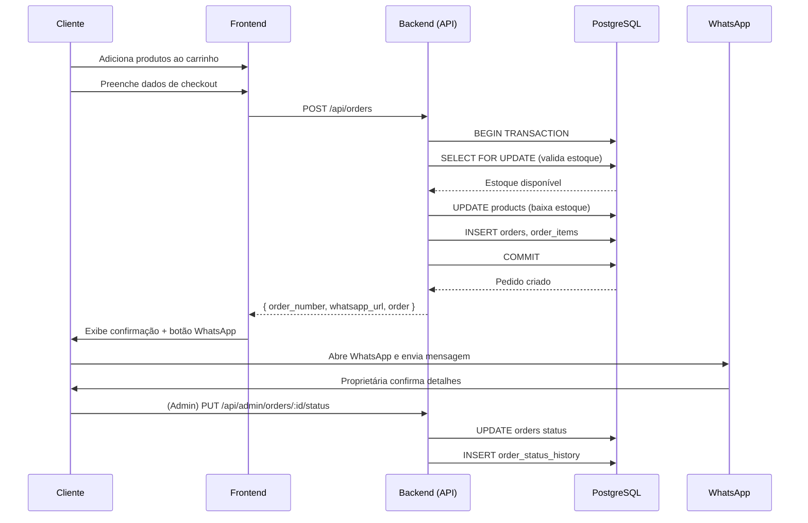

# Fluxo do Pedido — Eterna Cosméticos

Documentação completa do ciclo de vida de um pedido, desde a montagem do carrinho até a conclusão ou cancelamento.

---

## Visão Geral do Fluxo

```
[Carrinho] → [Checkout] → [Validação] → [Pedido Criado] → [WhatsApp] → [Admin confirma] → [Finalização]
```

---

## Fluxo Detalhado

### 1. Cliente Monta o Carrinho

- O cliente navega pela loja e adiciona produtos ao carrinho.
- O carrinho é **mantido no frontend** (estado React + localStorage) — não há persistência no banco neste momento.
- A disponibilidade de estoque é exibida na tela com base na consulta `GET /api/products/:slug`.
- O cliente pode alterar quantidades e remover itens.

**Dados mantidos no carrinho:**
```json
[
  { "product_id": "uuid", "name": "Produto X", "price": 29.90, "quantity": 2, "image_url": "..." }
]
```

---

### 2. Cliente Vai para o Checkout

- O cliente clica em "Finalizar Pedido" ou similar.
- O sistema calcula subtotal e aplica desconto (se houver cupom).
- O cliente escolhe a **forma de retirada**:
  - **Retirada na loja** (`pickup`): sem informações adicionais
  - **Entrega** (`delivery`): preenche endereço de entrega

---

### 3. Cliente Preenche os Dados

Campos obrigatórios:
- **Nome completo**
- **Telefone** (WhatsApp)
- **E-mail** (opcional)
- **Forma de retirada** (pickup ou delivery)
- **Endereço** (apenas se delivery)
- **Cupom de desconto** (opcional — validado em tempo real via `POST /api/coupons/validate`)

---

### 4. Backend Valida o Estoque (Transaction)

Ao submeter o pedido (`POST /api/orders`), o backend executa uma **transação atômica** no PostgreSQL:

```sql
BEGIN;
  -- Para cada item do pedido:
  SELECT stock_quantity FROM products WHERE id = $1 FOR UPDATE;
  -- Se stock_quantity < quantidade solicitada → ROLLBACK + erro 400
  UPDATE products SET stock_quantity = stock_quantity - $quantidade WHERE id = $1;
COMMIT;
```

**Por que `FOR UPDATE`?**
Garante que dois clientes não comprem o mesmo último item simultaneamente. O `FOR UPDATE` trava o registro até o `COMMIT`, evitando condições de corrida (_race conditions_).

**Se algum produto tiver estoque insuficiente:**
- A transação é revertida (`ROLLBACK`)
- Nenhum estoque é alterado
- O cliente recebe o erro com o nome do produto em falta

---

### 5. Pedido Criado com Status `pending_contact`

Após validação e baixa de estoque, o backend:

1. Cria ou atualiza o registro de **cliente** (upsert por telefone)
2. Cria o registro de **pedido** com status `pending_contact`
3. Cria os **itens do pedido** com snapshot de preço e nome (preserva histórico mesmo que o produto seja alterado)
4. Se houver cupom: cria registro em `coupon_usages` e incrementa `coupons.uses_count`
5. Registra a movimentação de estoque em `inventory_movements`
6. Registra o status inicial em `order_status_history`
7. Gera a **URL do WhatsApp**

**Formato do número do pedido:** `ET-YYYYMMDD-NNNN` (ex: `ET-20241113-0001`)

---

### 6. URL do WhatsApp Gerada

O serviço `whatsappService` monta a mensagem automaticamente:

```
*Olá! Gostaria de confirmar meu pedido:*

*Pedido:* ET-20241113-0001
*Nome:* Maria Silva

*Itens:*
- 2x Shampoo Hidratante — R$ 59,80
- 1x Condicionador X — R$ 24,90

*Subtotal:* R$ 84,70
*Desconto (PROMO10):* -R$ 8,47
*Total:* R$ 76,23

*Retirada:* Na loja

Aguardo confirmação! 😊
```

A URL tem o formato:
```
https://wa.me/5541999999999?text=<mensagem-codificada-em-URL>
```

---

### 7. Cliente Abre o WhatsApp

- O frontend exibe a URL do WhatsApp como botão.
- Ao clicar, o cliente é redirecionado para o WhatsApp Web ou app com a mensagem pré-preenchida.
- O cliente **envia a mensagem** para o número da loja.

> **Importante:** A mensagem não é enviada automaticamente. O cliente ainda precisa confirmar o envio no WhatsApp.

---

### 8. Admin Recebe a Mensagem

- A proprietária recebe a mensagem no WhatsApp da loja.
- Pode verificar o pedido no painel administrativo usando o número do pedido.
- Combina detalhes de pagamento e entrega diretamente no chat do WhatsApp.

---

### 9. Admin Confirma no Painel

Ao confirmar o pedido, o admin usa `PUT /api/admin/orders/:id/status`:

```json
{
  "status": "confirmed",
  "notes": "Pagamento via PIX recebido"
}
```

Essa ação:
- Atualiza `orders.status`
- Registra em `order_status_history` com o admin que fez a alteração e as notas
- Atualiza `customers.order_count` e `customers.total_spent`

---

### 10. Fluxo de Status Completo

```
pending_contact
      │
      ▼
  confirmed ──────────────────────────┐
      │                               │
      ▼                               │
  preparing ──────────────────────────┤
      │                               │
      ▼                               │
    ready ──────────────────────────  │
      │                               │
      ▼                               ▼
  completed                       cancelled
```

| Status              | Significado                                              |
|---------------------|----------------------------------------------------------|
| `pending_contact`   | Pedido criado, aguardando confirmação via WhatsApp       |
| `confirmed`         | Admin confirmou o pedido e o pagamento                   |
| `preparing`         | Pedido em separação/preparação                           |
| `ready`             | Pronto para retirada ou saiu para entrega                |
| `completed`         | Pedido entregue/retirado com sucesso                     |
| `cancelled`         | Pedido cancelado (qualquer status anterior)              |

---

### 11. Cancelamento e Restauração de Estoque

Quando o status é alterado para `cancelled`:

```sql
BEGIN;
  -- Para cada item do pedido:
  UPDATE products
  SET stock_quantity = stock_quantity + item.quantity
  WHERE id = item.product_id;

  -- Registra movimentação de estoque
  INSERT INTO inventory_movements (product_id, type, quantity, reason, order_id, ...)
  VALUES ($1, 'in', $2, 'Cancelamento pedido ET-XXXXXXXX', $3, ...);
COMMIT;
```

**Regras de cancelamento:**
- Qualquer admin pode cancelar um pedido em qualquer status anterior a `completed`
- O estoque é sempre restaurado no momento do cancelamento
- O cancelamento de cupom **não** decrementa `uses_count` (decisão de design: evita abuso de cupons por cancelamentos repetidos)
- O histórico de status registra quem cancelou e o motivo (campo `notes`)

---

## Diagrama Resumido


